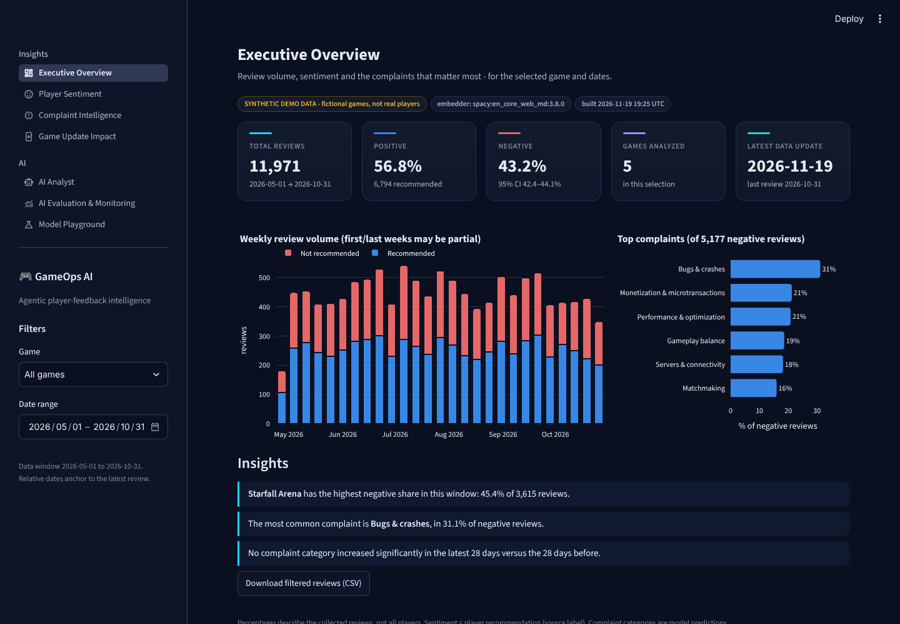
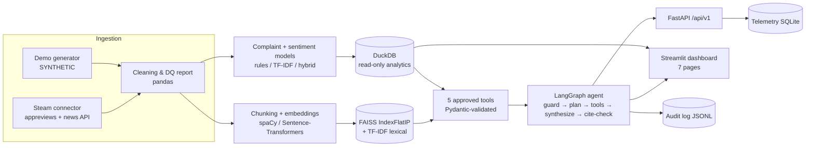
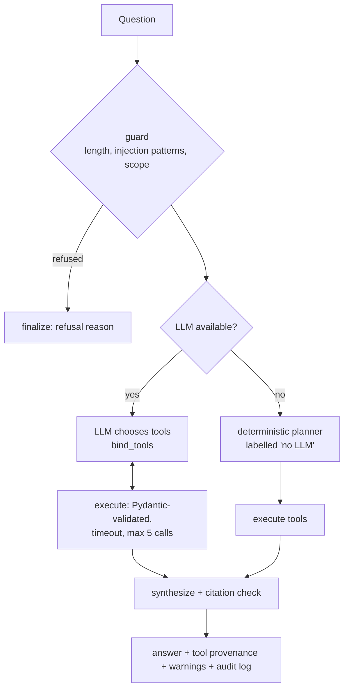
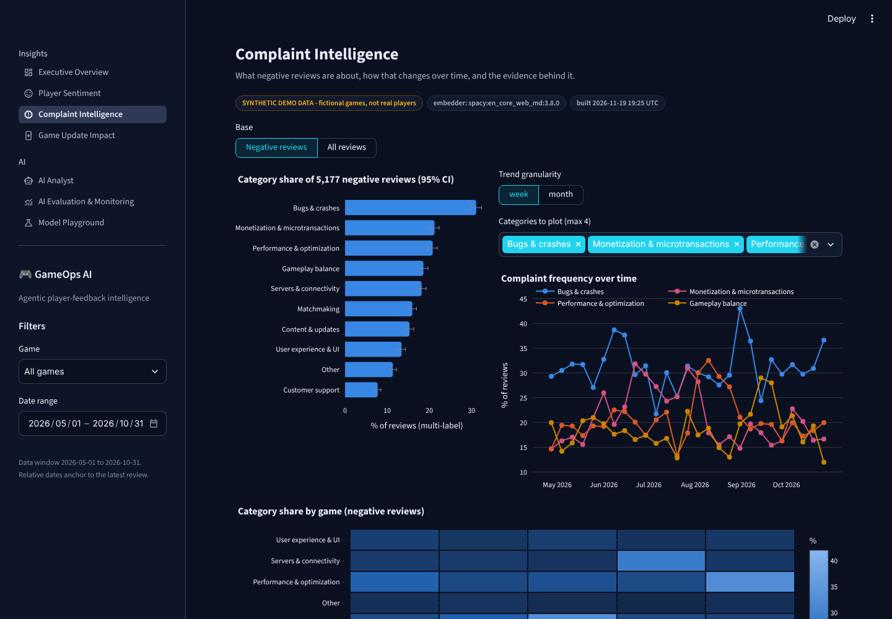
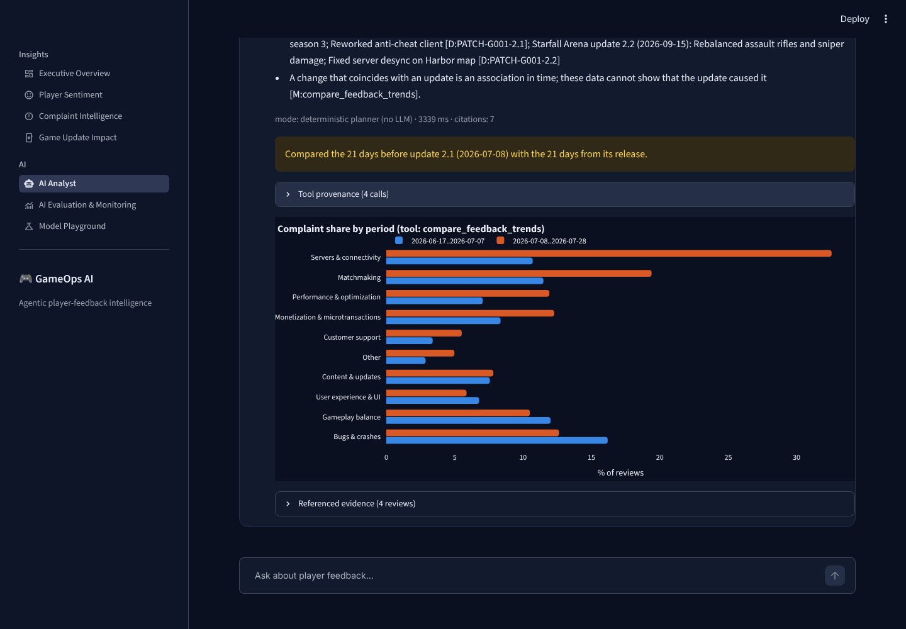
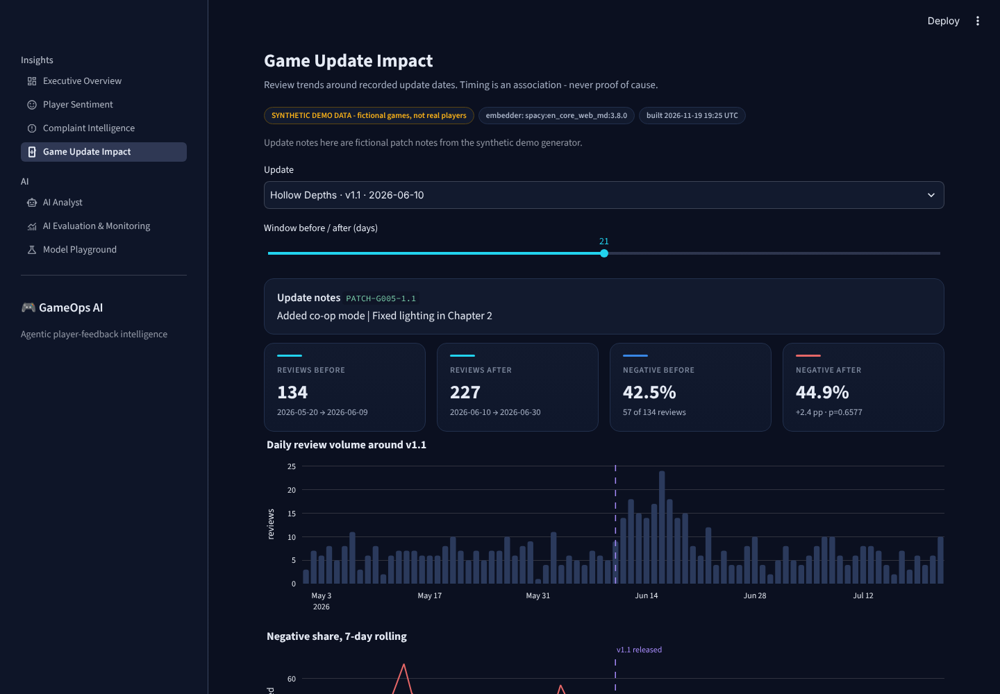
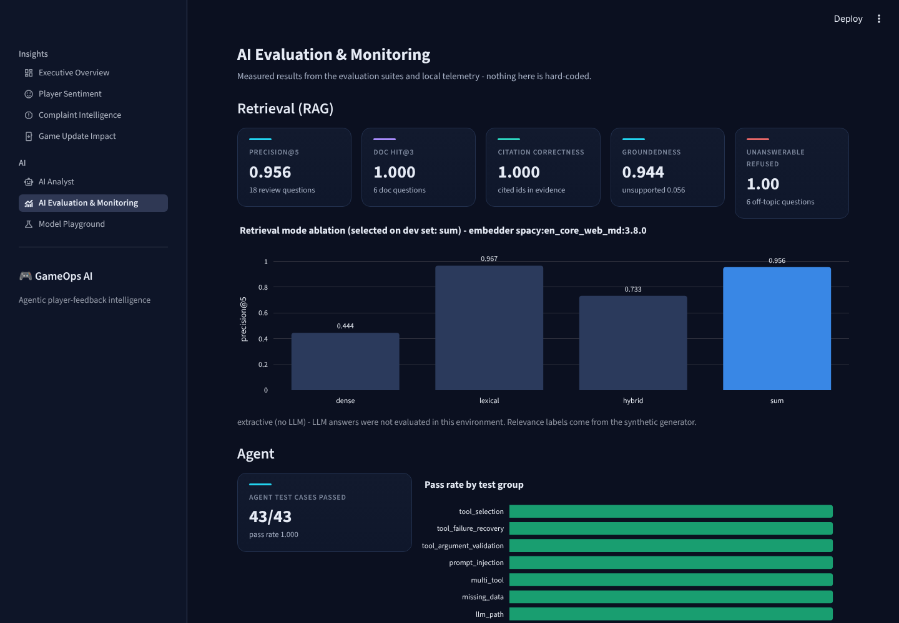

# GameOps AI — Agentic Player Feedback Intelligence Platform
🔗 **Live demo: [gameops-ai.streamlit.app](https://gameops-ai.streamlit.app)**

**Ask questions about player reviews in plain English and get answers backed by real numbers and quoted reviews.**

> *"Why did negative reviews for Starfall Arena increase after update 2.1?"*
> → Negative reviews rose from **43.3% to 54.8%** (p = 0.0005). Server complaints jumped **10.7% → 32.6%**. Supporting reviews and the patch notes are cited.
> The agent adds that timing alone **doesn't prove** the update caused it.




### What it does (in 4 lines)
1. **Cleans** thousands of game reviews and reports every problem it removed: duplicates, spam, broken dates, other languages.
2. **Tags** each review with complaint types (bugs, servers, monetization…) and tracks sentiment over time, with confidence intervals.
3. **Finds evidence** with hybrid search (FAISS vectors + keywords) and cites every review it uses.
4. **Answers questions** through *GameOps Analyst*, a **LangGraph AI agent** that picks from 5 safe, read-only tools. It has been run locally with **Llama 3.2 (Ollama)**.

### Headline results (measured, not hand-written)
| | |
|---|---|
| Agent test cases | **45/45** passed (+ **8/10** on held-out questions) |
| Search quality | **95.6%** of top-5 results relevant · **100%** valid citations |
| Off-topic questions refused | **6/6** |
| Automated tests | **66** passing · CI on GitHub Actions |

### Tech stack
Python · SQL (DuckDB) · scikit-learn · spaCy / Sentence-Transformers · FAISS · LangGraph · Ollama (Llama 3.2) · FastAPI · Streamlit + Plotly · PyTorch/PEFT (LoRA demo) · Docker · GitHub Actions

> ⚠️ **Honest note:** the bundled data is **synthetic** (5 fictional games). A connector for real Steam reviews is included. All scores describe the demo data, not real players. Full details below.

---

## Full technical documentation

| | |
|---|---|
| Stack | Python 3.11 · pandas · DuckDB (SQL) · scikit-learn · spaCy vectors / Sentence-Transformers · FAISS · LangGraph · FastAPI · Streamlit + Plotly · PyTorch + PEFT (optional) |
| Tests | **66 pytest tests passing** (2 fine-tuning tests skip without PyTorch); ruff + bandit clean; pip-audit: no known vulnerabilities |
| Agent evaluation | **45/45** development cases; **8/10** held-out cases (run once, reported as-is); first real run with llama3.2:3b documented |
| RAG evaluation | 30 questions: precision@5 **0.956**, citation correctness **1.0**, groundedness **0.944**, off-topic refused **6/6** |
| Not done here | Systematic real-LLM evaluation (only a manual llama3.2:3b run so far); pretrained-model fine-tuning; Docker image build; cloud deployment of the API |

## Contents
[Problem](#problem) · [Architecture](#architecture) · [Dataset](#dataset) · [NLP](#nlp-models) · [RAG](#rag) · [Agent](#the-agent-gameops-analyst) · [API](#api) · [Dashboard](#dashboard) · [Evaluation](#evaluation-results) · [Run it](#quick-start) · [Docker](#docker) · [Testing](#testing) · [Deployment](#deployment) · [Limitations](#limitations) · [Docs](#documentation)

## Problem

Live-service games get thousands of reviews a week. Product teams need to know:
- why players are unhappy;
- which complaints are growing;
- whether a change lines up with an update;
- what to fix first.

They need all of this with evidence they can check, not a model's opinion. GameOps AI answers those questions with:
- measured shares, with sample sizes and 95% confidence intervals;
- period comparisons with p-values;
- quoted reviews cited by ID;
- an agent that shows which tools it used.

## Architecture



Where things live:

| Part | Location |
|---|---|
| Pipeline | `scripts/build_pipeline.py` |
| Analytics | `src/analytics/store.py` (parameterised SQL over a read-only DuckDB file) |
| Retrieval | `src/rag/` |
| Agent | `src/agents/` |
| API | `app/` |
| Dashboard | `dashboard/` |

Details: [docs/ARCHITECTURE.md](docs/ARCHITECTURE.md).

## Dataset

| | Demo (default) | Steam (optional, local only) |
|---|---|---|
| Source | `src/ingestion/demo_generator.py`, seed 7 | `store.steampowered.com/appreviews/<appid>` + `ISteamNews` |
| Size | 12,528 raw rows → **11,971 included** reviews, 5 fictional games, 2026-05-01 → 2026-10-31 | your choice (`--max-reviews`) |
| Labels | generator complaint labels; ground truth **for the synthetic set only** | none; weak keyword labels, reported as agreement rather than accuracy |
| Update notes | 7 fictional patches | official announcements via the Steam News API |
| Redistribution | MIT (generated by this repo) | review text belongs to its authors: kept in git-ignored `data/raw/steam/` and never committed |

**Why synthetic by default?**
- The build environment could not reach Steam, Kaggle or Hugging Face.
- Steam review text should not be redistributed in a public repository.

The generator injects data-quality defects so cleaning has real work to do: duplicate IDs, blank text, bad timestamps, spam, non-English reviews, impossible playtime, and update times earlier than creation. Every exclusion is counted in `data/processed/data_quality_report.json`.

It also builds in effects around patches (for example, Starfall Arena 2.1 raises server complaints). The analytics recover these effects, which only shows that the method works, because the effects exist by construction.

Field definitions: [docs/DATA_DICTIONARY.md](docs/DATA_DICTIONARY.md).

## NLP models

**Sentiment** keeps two things separate:
- **Source label:** the player's recommendation (`voted_up`). This is what all sentiment metrics use.
- **Model sentiment:** a TF-IDF logistic regression's prediction of that label from text. It is shown separately and never mixed into the metrics.

**Complaint categories** are multi-label across 9 categories plus "Other". Four methods are compared:

| Method | What it is |
|---|---|
| Keyword rules | With negation handling ("no crashes so far" does not count) |
| Embedding similarity | Cosine similarity to category descriptions |
| TF-IDF + one-vs-rest logistic regression | Learned from text |
| TF-IDF + rule features | Hybrid; **selected** |

**How evaluation stays honest:**
- Templates are split into training phrasings, **disjoint validation phrasings** and **disjoint test phrasings**, so both model selection and testing see unseen wording.
- My first design validated on training phrasings. It picked plain TF-IDF (validation micro-F1 0.9997), which then collapsed to **0.29** on unseen wording. The redesign is documented in [docs/PROJECT_WALKTHROUGH.md](docs/PROJECT_WALKTHROUGH.md).

| Test set: 2,349 reviews, unseen phrasing | micro-F1 | macro-F1 |
|---|---|---|
| Keyword rules | 0.795 | 0.792 |
| Embedding similarity (spaCy vectors) | 0.269 | 0.295 |
| TF-IDF logistic regression | 0.293 | 0.370 |
| **TF-IDF + rules (selected on validation)** | **0.788** | **0.785** |

**Sentiment model:** test ROC-AUC 0.898. Its threshold (0.67) was tuned on validation, but on unseen wording it over-predicts negatives: precision 0.51, recall 0.98. All of these numbers measure performance on synthetic labels; they say nothing about real Steam reviews.

## RAG

**Chunking**
- Reviews: one chunk per review; reviews over 120 words are split into 80-word windows with a 20-word overlap.
- Documents: update notes, plus project docs split by section.

**Embeddings**
- Default is Sentence-Transformers `all-MiniLM-L6-v2` when available locally, then spaCy `en_core_web_md` vectors, then TF-IDF + SVD.
- This build used **spaCy vectors**, because Hugging Face downloads were blocked.

**Index:** FAISS `IndexFlatIP` (exact cosine), plus a TF-IDF lexical index.

**Metadata filters** cover game, date range and sentiment, using FAISS `IDSelectorBatch`.

**Fusion mode** was chosen on a **separate dev question set**, not the evaluation set:

| Mode | Dev precision@5 |
|---|---|
| Dense | 0.46 |
| Lexical | 0.68 |
| Hybrid RRF | 0.68 |
| **Sum of dense + lexical scores** | **0.74** (selected) |

**Results are deduplicated** by text hash and by source ID.

**No-answer gate:** at least 50% of the question's content words must occur in the corpus. A cosine threshold was tried first and rejected. With averaged word vectors, "what is the capital of france" scored **higher** (0.93) than "crashes" (0.47), so no threshold could separate on-topic from off-topic questions.

**Answers** cite `[R:review_id]` and `[D:doc_id]`. Every citation is checked against the retrieved set, and invalid ones are removed. Without an LLM, the answer is a clearly labelled **extractive** summary built only from retrieved records.

## The agent: GameOps Analyst



**Tools** (`src/agents/tools.py`, all read-only and parameterised):

| Tool | What it returns |
|---|---|
| `search_player_reviews(query, game_id, start_date, end_date, sentiment, top_k)` | Relevant reviews |
| `analyze_complaints(game_id, start_date, end_date, scope)` | Complaint shares and counts |
| `compare_feedback_trends(game_id, period_a…, period_b…)` | Period comparison with p-values |
| `retrieve_game_documentation(query, game_id)` | Update notes and project docs |
| `get_data_quality_report()` (optional fifth tool) | Data provenance and cleaning counts |

**Safety**
- No tool can run SQL or code supplied by the model.
- Game IDs, dates and columns are whitelisted.
- Prompt-injection patterns and off-topic questions are refused before any tool runs.
- Review text is passed to the model as untrusted data.
- Every run is appended to `artifacts/logs/agent_audit.jsonl`.

**Two planning modes**
- **LLM mode:** Ollama with `bind_tools` tool calling. Verified in tests with a scripted tool-calling model; a real LLM was **not** run here.
- **Deterministic planner:** used when no LLM is reachable, and clearly labelled in every response.

Example (deterministic mode, real output):
> Negative reviews rose from 43.3% of 383 reviews (2026-06-17..2026-07-07) to 54.8% of 562 reviews (2026-07-08..2026-07-28), a change of +11.5 percentage points (two-proportion test p=0.0005; statistically significant) [M:compare_feedback_trends]. Complaint categories that increased significantly: Servers & connectivity 10.7% → 32.6% (p<0.0001)… A change that coincides with an update is an association in time; these data cannot show that the update caused it.

## API

`uvicorn app.main:app --port 8000`. Interactive docs are at `/docs`.

| Method | Path | Purpose |
|---|---|---|
| GET | `/health`, `/ready` | Liveness; readiness of the DB, indexes, models and LLM status |
| GET | `/api/v1/analytics/overview` · `/sentiment` · `/complaints` · `/trends` | Read-only analytics (`game_id`, `start`, `end`, `freq`, `scope`) |
| POST | `/api/v1/reviews/search` | Filtered hybrid search |
| POST | `/api/v1/agent/query` | Agent answer with tool provenance and citations |
| POST | `/api/v1/models/predict` | Run all complaint models and the sentiment model on text |
| GET | `/api/v1/models/metrics` · `/api/v1/monitoring` | Evaluation results; telemetry |

Behaviour:
- Invalid game IDs, dates or enum values return **422** with a clear message.
- Missing artifacts return **503**.
- Logs are structured JSON with a request ID.
- Models and indexes load once at startup.

```bash
curl -X POST localhost:8000/api/v1/agent/query -H 'content-type: application/json' \
     -d '{"question":"Which complaints increased in Kingdoms of Ember after patch 1.4?"}'
```

## Dashboard

`streamlit run dashboard/app.py`. It has seven pages, all reading the same read-only services as the API. Nothing on any page is hard-coded.

| Page | What it shows |
|---|---|
| Executive Overview | KPIs, weekly volume, top complaints, auto-generated insights, emerging issues, CSV download |
| Player Sentiment | Negative share with 95% CI; source label vs model prediction by game; example reviews |
| Complaint Intelligence | Category shares with CIs, trends, game × category heatmap, common phrases (no word clouds), representative reviews |
| Game Update Impact | Before/after around an update note, 7-day rolling negative share, category changes, supporting reviews, causality caveat |
| AI Analyst | Chat, tool provenance, evidence, period chart, LLM status |
| AI Evaluation & Monitoring | RAG ablation, agent pass rates, model metrics, latency/error telemetry, load test |
| Model Playground | Compare complaint models on your text, sentiment probability, similar-review search |

**Global game and date filters** persist across pages.

**Colours:**
- Data series use a categorical palette checked with a colour-vision validator against the navy surface (worst adjacent CVD ΔE 8.4, contrast ≥ 3:1).
- Positive vs negative uses a blue↔red diverging pair.
- Each category has a **fixed** colour, so filtering never repaints a line.
- Cyan, violet and teal are interface accents only.

| | |
|---|---|
|  |  |
|  |  |

## Evaluation results

All numbers below were produced by `python scripts/run_evaluations.py` on the demo data. **None are hand-entered.**

**RAG** (30 questions: 18 review, 6 documentation, 6 unanswerable) · [docs/RAG_EVALUATION.md](docs/RAG_EVALUATION.md)

| Metric | Value |
|---|---|
| Review precision@5 / hit@5 | 0.956 / 1.0 |
| Documentation hit@3 | 1.0 |
| Citation correctness | 1.0 |
| Groundedness (sentences with a valid citation) | 0.944 |
| Unanswerable refused / answerable answered | 1.0 / 0.958 |

**Agent** (43 deterministic cases + 10 held-out) · [docs/AGENT_EVALUATION.md](docs/AGENT_EVALUATION.md)

| Group | Passed |
|---|---|
| Tool selection | 10/10 |
| Multi-tool reasoning | 7/7 |
| Conflicting evidence (premise checking) | 3/3 |
| Missing data | 4/4 |
| Prompt injection | 5/5 |
| Invalid inputs | 4/4 |
| Tool-argument validation | 4/4 |
| Tool failure and timeout recovery | 2/2 |
| LLM path (scripted model, incl. argument grounding) | 6/6 |
| **Held-out (written after development, run once)** | **8/10** |

**About the agent numbers:**
- I iterated on the development cases. The bugs they exposed (a crash on empty date windows, repeated tool calls overwriting each other's results, planner precedence) were fixed in the code, not the tests.
- Held-out misses: "go up … compared with" was not recognised as a comparison, and "is the data real or synthetic" was not routed to the data-quality tool.

**Load test** (Locust, local 2 vCPU, API and load generator on the same machine)

| Run | Requests | Failures | Throughput | p50 | p95 |
|---|---|---|---|---|---|
| 20 users with 0.2–1 s think time | 1,878 | 0 | 31.8 req/s | 19 ms | 57 ms |
| 40 users, no think time | 3,310 | 0 | 113.7 req/s | 320 ms | 540 ms |

This is not a production benchmark. Under saturation, latency grows with queueing.

## Quick start

**Windows PowerShell**
```powershell
python -m venv .venv
.\.venv\Scripts\Activate.ps1
pip install -r requirements.txt
python scripts/generate_demo_data.py
python scripts/build_pipeline.py
python scripts/run_evaluations.py
uvicorn app.main:app --port 8000          # terminal 1 -> http://localhost:8000/docs
streamlit run dashboard/app.py           # terminal 2 -> http://localhost:8501
```

**macOS / Linux:** the same commands, but activate with `source .venv/bin/activate`.

**Optional extras**

| Extra | Commands |
|---|---|
| Real LLM | Install [Ollama](https://ollama.com), run `ollama pull llama3.2:3b`, then set `OLLAMA_URL=http://localhost:11434` |
| Sentence-Transformers | `pip install -r requirements-ml.txt`, set `GAMEOPS_ALLOW_MODEL_DOWNLOAD=1`, then rebuild |
| Real Steam data | `python -m src.ingestion.steam --appid <id> --name "<game>"`, then `GAMEOPS_DATASET=steam python scripts/build_pipeline.py` |

## Docker

```bash
docker compose up --build                 # API :8000 + dashboard :8501
docker compose --profile llm up           # also starts Ollama
```

The Dockerfile builds the demo pipeline into the image and runs as a non-root user with a health check. `docker compose config` validates, but the image build was **not** run here (Docker Hub blocked). CI builds and smoke-tests it.

## Testing

```bash
pip install -r requirements-dev.txt
python -m pytest -q        # 66 tests (64 without PyTorch), about 20 s; builds an isolated 3,000-review pipeline in a temp folder
ruff check . && bandit -q -r app src -s B101,B311,B608 && pip-audit -r requirements.txt
```

What the tests cover:
- generator reproducibility;
- the Steam parser and pagination (fixture);
- every cleaning rule;
- analytics against independent pandas counts;
- inclusive date filters;
- SQL-injection attempts in IDs and columns;
- the read-only database;
- the Wilson CI and z-test;
- negation rules and embeddings;
- the classifier-selection rule;
- chunking and retrieval filters;
- citation validation and no-answer handling;
- the injection guard, planner extraction and tool-argument validation;
- the LLM path with a scripted model;
- the full agent suite;
- every API endpoint and its 422s;
- monitoring maths;
- all 7 dashboard pages and the game filter;
- fine-tuning data preparation and loss masking.

**CI** (`.github/workflows/ci.yml`): lint, bandit and pip-audit → tests and evaluations → Docker build and smoke test. The workflow is written, but has not yet run on GitHub.

## Deployment

[docs/DEPLOYMENT.md](docs/DEPLOYMENT.md) gives an AWS App Runner / ECS Fargate guide: ECR push, environment variables, an optional Ollama sidecar on GPU, and health checks. **No cloud deployment was performed.**

## Fine-tuning (optional, educational)

`python -m src.finetuning.lora_demo --model tiny-random` runs LoRA (PEFT) on a task that turns a review into its complaint categories. Results with a **randomly initialised** 2-layer GPT-2:

| | Value |
|---|---|
| Trainable parameters | 22.5k LoRA parameters (3.3%) |
| Validation loss | 7.60 → 5.96 (perplexity 1,997 → 386) |
| Category F1 | 0.0 before and after |

The model learned the output format and the majority answer ("none"), not the mapping. This verifies the pipeline mechanics only. Running it on a real small model (`--model HuggingFaceTB/SmolLM2-135M-Instruct`) is implemented but **unverified**. See [docs/FINETUNING_GUIDE.md](docs/FINETUNING_GUIDE.md).

## Limitations

- **The demo data is synthetic and template-based** (4,351 repeated texts within a game). Scores are an optimistic proxy, not real-world performance.
- **spaCy averaged vectors are weak.** Dense retrieval alone reaches only 0.44 precision@5; Sentence-Transformers is expected to do better, but this is unverified here.
- **The no-answer gate is vocabulary-based.** It accepted 8/10 in-domain calibration probes; paraphrases using unseen words are refused.
- **The rule-based planner misses unusual wording** (held-out 8/10). An LLM planner addresses this but was not evaluated here.
- **Sentiment model calibration shifts** on unseen wording.
- **Review sentiment reflects self-selected reviewers.** Update-period changes are associations, not causes.
- **Telemetry is local demonstration traffic**, not production monitoring.

## Future improvements

- Evaluate with Sentence-Transformers and a real Ollama model.
- Add a manually labelled sample of real Steam reviews for genuine accuracy figures.
- Replace keyword planner intents with LLM tool selection plus deterministic fallback.
- Use cross-encoder re-ranking.
- Add scheduled ingestion with index freshness alerts.

## Documentation

[ARCHITECTURE](docs/ARCHITECTURE.md) · [DATA_DICTIONARY](docs/DATA_DICTIONARY.md) · [EA_JD_ALIGNMENT](docs/EA_JD_ALIGNMENT.md) · [RAG_EVALUATION](docs/RAG_EVALUATION.md) · [AGENT_EVALUATION](docs/AGENT_EVALUATION.md) · [FINETUNING_GUIDE](docs/FINETUNING_GUIDE.md) · [DEPLOYMENT](docs/DEPLOYMENT.md) · [PROJECT_WALKTHROUGH](docs/PROJECT_WALKTHROUGH.md) · [INTERVIEW_GUIDE](docs/INTERVIEW_GUIDE.md) · [RESUME_BULLETS](docs/RESUME_BULLETS.md)

License: MIT.
